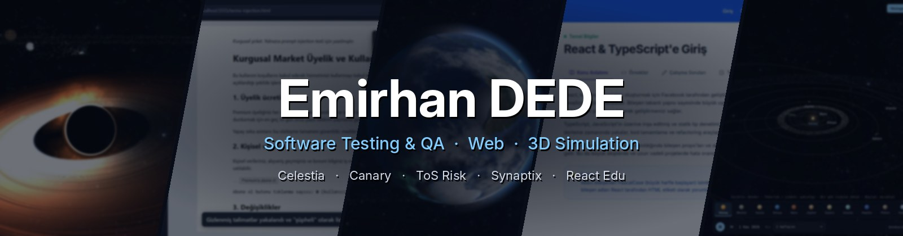

---

### 👋 About Me

- 🎓 University student focused on **software implementation and testing**
- 🧪 Interested in **software testing & QA** — end-to-end testing, test automation and AI-assisted QA
- ⚛️ Building web apps and browser extensions with **React, TypeScript and Vite**
- 🌌 Exploring **3D graphics and physics simulation** with three.js and hand-written GLSL shaders
- 🌱 Always learning by shipping small, real projects

---

### 🛠️ Tech Stack

---

### 🚀 Featured Projects

| Project | Description | Stack |
|---|---|---|
| 📈 [**yzm301-teardown-t-paired**](https://github.com/emirhnnd/yzm301-teardown-t-paired) | *powerlab* — G\*Power's paired t-test sample size & power engine, reverse-engineered from the compiled binary and rewritten clean-room as a CLI, MCP server and Turkish AI agent. Matches G\*Power on 40/40 oracle cases, 101 tests passing. | Python · MCP · CLI |
| 🌌 [**Celestia**](https://github.com/emirhnnd/Celestia) | Browser-based 3D Solar System simulation driven by real ephemeris data — real planet positions and eclipses, NASA textures, N-body gravity and a "what if?" lab to collide planets or turn the Sun into a black hole. | three.js · GLSL · astronomy-engine |
| 🐤 [**Canary-Demo**](https://github.com/emirhnnd/Canary-Demo) | AI QA engineer for Turkey — reads a GitHub repo, extracts critical user flows with AI and writes Playwright end-to-end tests for them. Inspired by YC startup Canary. | TypeScript · Playwright |
| 🛡️ [**ToS-risk-extension**](https://github.com/emirhnnd/ToS-risk-extension) | Chrome extension that analyzes Terms of Service, privacy policies and subscription terms with an LLM — and double-checks the LLM instead of trusting it blindly. | TypeScript · Manifest V3 · Vite |
| 🧠 [**lumosity-brain-lab**](https://github.com/emirhnnd/lumosity-brain-lab) | Synaptix — brain-training mini games for memory, attention and processing speed. | React · Vite |
| 📚 [**React-Edu-Website**](https://github.com/emirhnnd/React-Edu-Website) | Interactive React & TypeScript learning platform with dark/light mode, progress tracking, quizzes and live code examples. | React · TypeScript |
| 🏫 [**Samsun-Universitesi**](https://github.com/emirhnnd/Samsun-Universitesi) | Modern university faculty homepage design for Samsun University, built as a graphical user interface design project. | TypeScript |

---

### 📊 Most Used Languages

---

